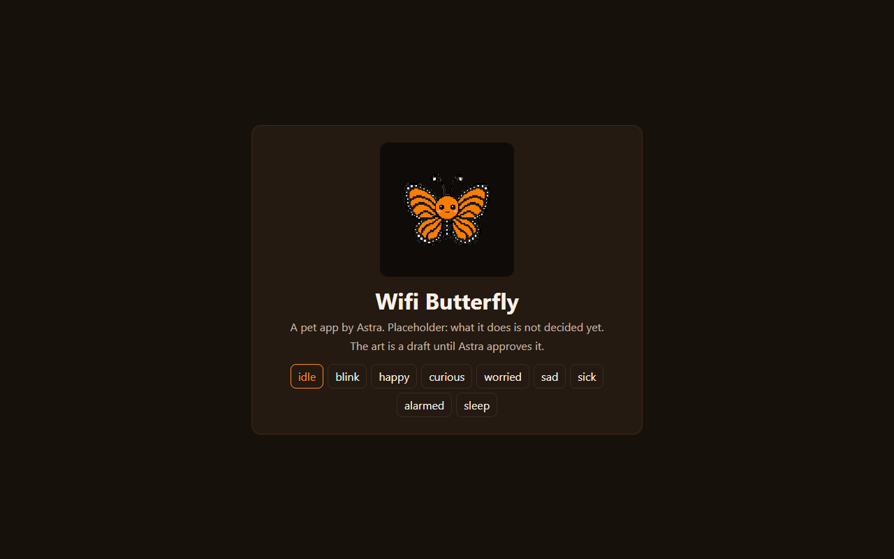

# Wifi Butterfly

*A pet app by Astra.*

Wifi Butterfly is a monarch butterfly pet. It's seeded: it has its pet, nine moods, an app icon and a placeholder app. What it does is not decided yet (see [card 001](handoffs/001-any-decide-the-job.md)).

## Pictures

Wifi Butterfly's program page (`wifi-butterfly-20261009.html`) on `main`. What it does is not decided yet.

Screenshots taken 2026-10-17 with GitHub Goldfish's [project-image-generator](https://github.com/findastra/github-goldfish#project-image-generator); added with Claude Opus 5.5 (`claude-opus-5-5`), 2026-10-17.

## How to run it

Open `wifi-butterfly-20261009.html` in any modern browser. It shows the pet in its pet well with a mood picker, and nothing else. `index.html` is the older one-line placeholder.

## Limits

- No job yet, so there is no behaviour, data or storage.
- The pet art is a **draft** until Astra approves it. Frames are in `art/` and listed in `sprite-20261009.json`.
- In the hub's registry as a pipeline pet ([pets.json](https://github.com/findastra/astras-pet-os/blob/main/pets.json)): it has its own repo and is not registered yet. The art already exists, so it doesn't need generating again: see [docs/plan-20261009.md](docs/plan-20261009.md).
- Part of Astra's PetOS. See the [pet file rules](https://github.com/findastra/astras-pet-os/blob/main/PET-FILES.md) and [pet words](https://github.com/findastra/astras-pet-os/blob/main/PET-WORDS.md).

Desktop appearance draft updated 2026-10-11: see [desktop details](desktop-pet-20261011.json). This changes the desktop pet, not application features.
